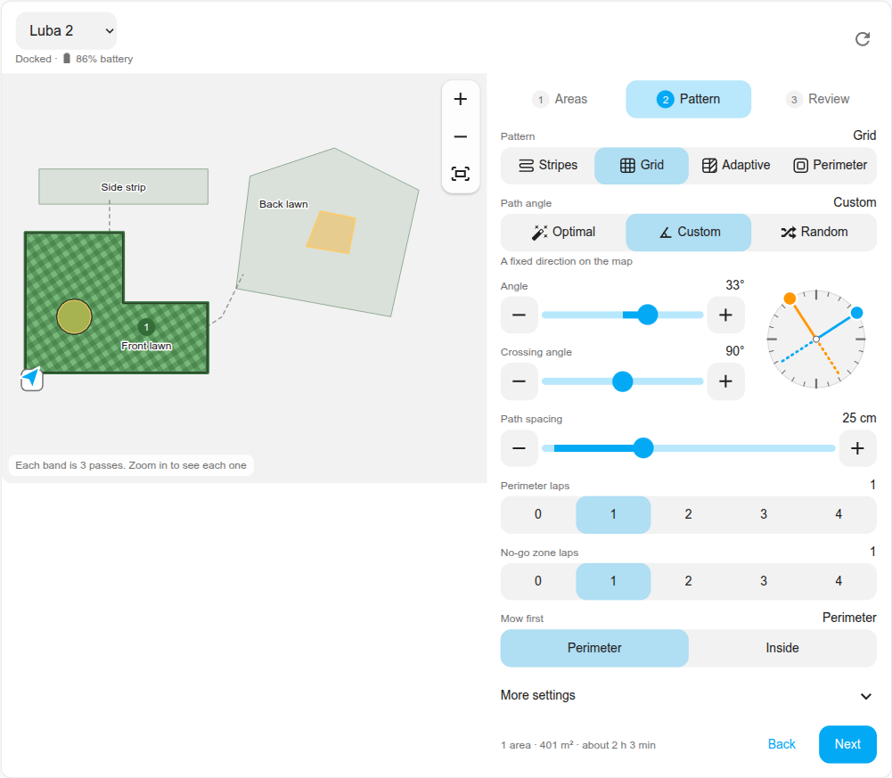

# Mammotion Mow Planner Card

A Home Assistant dashboard card for the [Mammotion integration](https://github.com/mikey0000/Mammotion-HA). Pick the areas to mow on the map, set the pattern, and see what the mow will look like before you start it.



- **Areas.** Tap areas on the map or in the list. They are mowed in the order you tap them.
- **Pattern.** Change the path angle, pattern, path spacing, perimeter laps and no-go zone laps, and watch the stripes redraw on the map as you drag. Turn the path angle with the clock dial beside the angle sliders: drag a hand, or focus it and use the arrow keys (Shift for 15° steps). **Grid** adds a second hand for the crossing angle, which turns along with the first. **More settings** holds speed, cutting height, edge coverage, obstacle detection, auto-reverse direction, start progress and, on Yuka models with a grass collector, the collection settings.
- **Review.** Check the summary, the path length and the estimated time, then start the job.

The card shows a setting only when your mower has the matching integration entity, and takes its range or choices from that entity, so each model gets the settings it actually has.

The card reads the map and your current settings from the integration. A job is only sent after you press **Start mowing** and then confirm with **Start now**. Changing a setting in the card saves it to the mower's own setting in the integration (the planning select, number and switch entities), so the next visit, on any device, starts from it. Dragging a slider or the dial saves once you let go and the value settles. If a save fails, the card says so and shows the stored value again. With integration 0.6.25 or newer the chosen areas are saved too, in mowing order, to the integration's area switches; with an older one they stay in the card and travel with the start command. During a job nothing is saved; changes go to the running job instead (see [During a job](#during-a-job)). With an integration older than 0.6.24 settings are not saved and travel with the start command only.

## Requirements

- Home Assistant 2024.11 or newer.
- The Mammotion integration, with at least one mower that has a map.
- Mammotion integration 0.6.24 or newer for **Find optimal direction**, **Get route from mower** (`mammotion.plan_route`) and for changing a running job exactly (the `running_job` attributes). Older versions get the rest of the card; see [During a job](#during-a-job) for what changes.
- Mammotion integration 0.6.25 or newer to save the chosen areas and their mowing order.

## Install

### HACS

1. HACS → ⋮ → **Custom repositories** → add this repository with type **Dashboard**.
2. Install **Mammotion Mow Planner Card**.
3. Reload the browser.

### Manual

1. Download `mammotion-mow-planner-card.js` from the latest release (or build it, see below).
2. Copy it to `config/www/`.
3. Settings → Dashboards → ⋮ → **Resources** → add `/local/mammotion-mow-planner-card.js` as a JavaScript module.

## Use

Add the **Mammotion Mow Planner** card from the card picker, or in YAML:

```yaml
type: custom:mammotion-mow-planner-card
```

| Option         | Type    | Default        | Description                                                                        |
| -------------- | ------- | -------------- | ---------------------------------------------------------------------------------- |
| `entities`     | list    | all mowers     | `lawn_mower` entities to offer. With more than one, the card shows a mower picker. |
| `title`        | string  | the mower name | Heading of the card.                                                               |
| `angle_offset` | number  | `0`            | Degrees added to custom path angles in the preview. See [Path angle](#path-angle). |
| `exact_route`  | boolean | `false`        | Offer **Get route from mower** in the review step. See [Limits](#limits).          |

The card works best at half a dashboard width or more. On a wide card the map sits beside the settings; on a phone it stays pinned above them while you scroll.

## How the preview is drawn

The preview is computed in the browser from the map and your settings. It is a faithful sketch, not the mower's own plan.

- Passes are drawn as mown bands, light and dark like a striped lawn, each one path spacing wide at the map's scale. When one pass would be too thin to see, several are grouped into one band and the map says how many; zoom in to see each pass.
- **Perimeter laps** are rings inside the boundary, one path spacing apart. **No-go zone laps** are rings around each no-go zone.
- **Grid** adds a second pass at the crossing angle, so the bands overlap into a check. **Adaptive** is drawn as plain stripes, because the mower splits the area into zones itself. **Perimeter** has no stripes.
- The estimated time is path length divided by speed. It ignores turns, travel between areas and charging, so expect the real job to take longer.

### Path angle

- **Custom** uses your angle as a fixed direction on the map: 0° runs east–west, 90° north–south.
- **Optimal** lets the mower choose the efficient direction, and your angle shifts it. Until you ask, the card guesses that direction from the long side of each area and marks the preview as approximate. **Find optimal direction** asks the mower, after you confirm, to plan plain stripes over the selected areas without mowing; the card reads the direction of each area off that plan and draws the bands and the dial from it. The answer is kept per area until the map is refreshed. The card never asks while the mower is busy; the integration also refuses while the mower holds an unfinished job. With an integration older than 0.6.24 the button is replaced by a note that a newer one is needed.
- **Random** changes direction every job. The card shows one example.

The mower measures custom angles in its own map frame, which can be rotated from true north. If the stripes on your lawn end up turned compared with the preview, set `angle_offset` to the difference.

## Limits

- The preview is a sketch, not the route the mower will take. `exact_route: true` adds **Get route from mower**, which after you confirm asks the mower to plan the job without starting and shows the route of that plan, through `mammotion.plan_route`. Planning never touches a job: the card doesn't ask a busy mower, and the integration refuses while one holds an unfinished job. If the mower shares no route, the card shows the integration's reason; over the cloud the integration's mow path fetching option has to be on.
- A setting whose entity is missing or has no value is left out of the start command unless you change it, so the job uses the integration's own value.
- Obstacle detection is offered only when its entity lists one of the option sets the integration is known to produce, because the code sent for **Off** differs between them.
- Starting a job while the mower is busy without a job to change, such as on its way home from a finished one, ends what it is doing first. The card warns you in the review step.
- Loading the map makes the integration start a five-minute status stream from the mower. The card loads the map once per mower and again when you press refresh.
- On a touchscreen one finger scrolls the dashboard; use two fingers, or the buttons, to move and zoom the map.

### During a job

While the mower has a job under way, the card changes that job instead of starting a new one. Areas are locked to the job's own, and only pattern, path spacing, no-go zone laps, speed, cutting height, obstacle detection, start progress and auto-reverse direction can be changed; the rest are greyed out. **Apply changes** sends only what you changed, through `mammotion.modify_running_job`, after you confirm.

- The integration reports whether a job is running, whether it can be changed, and the job's own settings. The card shows those values; a setting the job does not report shows the integration's planning value.
- The original Luba cannot change a running job, so every setting is greyed out on it.
- With an older integration that lacks these attributes, the card guesses: a job counts as running while the mower is mowing, paused or returning short of 100 % progress, the settings shown are the planning values, a mower without the random path angle is taken for the original Luba, and auto-reverse direction stays greyed out because that integration drops it from a running job. If the guess is wrong, the integration refuses the change and the card says so.

## Development

```sh
npm ci
npm run demo    # http://localhost:5173/demo/ with a mock Home Assistant
npm run check   # typecheck, lint, tests and build
```

The demo page runs the card against made-up mowers: a docked Luba 2, a Yuka Mini that is mowing, and a paused Yuka with a grass collector whose integration lacks the running-job attributes, to show the fallback. Service calls are listed under the card and never leave the page. Add `?dark`, `?lang=de`, `?lang=he` (right-to-left), `?single`, `?map=empty`, `?map=error` `?legacy` (an integration without `mammotion.plan_route`) or `?failsave` (every save fails) to the URL to try other states. Saved settings are kept in the browser across reloads; add `?reset` to start from the demo's defaults again.

`npm run build` writes `dist/mammotion-mow-planner-card.js`. Pushing a `v*` tag builds it and attaches it to the GitHub release, which is what HACS installs.

| Dependency         | Why                                                       |
| ------------------ | --------------------------------------------------------- |
| `lit`              | The element base Home Assistant itself uses.              |
| `clipper2-ts`      | Polygon offsetting and clipping for the laps and stripes. |
| `@panzoom/panzoom` | Drag, wheel and pinch on the map.                         |
| `@mdi/js`          | Icon paths; only the icons used are bundled.              |
